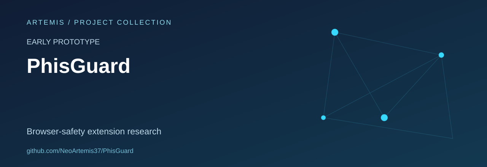

# PhishGuard Browser Extension Prototype

A browser-extension learning project exploring URL reputation checks and warning interfaces for potentially suspicious pages.

The repository name is **PhisGuard**; the extension manifest uses **PhishGuard**.

**Status:** incomplete prototype. It is not presented as a verified protective product or a published Firefox add-on.

## What is implemented

- A Manifest V3 extension declaration.
- A background script containing a Google Safe Browsing request.
- A content-script heuristic that examines a page's input fields and hostname.
- Popup and blocked-page interface files.

## Source map

| File | Role |
| --- | --- |
| `manifest.json` | Permissions and extension components |
| `background.js` | URL-reputation request and tab handling |
| `content.js` | Experimental page heuristic |
| `popup.html` | Popup interface |
| `blocked.html` and `blocked.js` | Warning and continuation interface |

## Current limitations

The manifest references icon files that are not included. The warning-message and continuation paths also need integration work, and Firefox compatibility has not been verified in this snapshot. The hostname heuristic is simplistic and should not be treated as reliable phishing detection.

URL-reputation checks can transmit visited URLs to the external provider. The project therefore does not claim that no browsing information leaves the browser.

## Development priorities

Complete the missing assets, test browser compatibility, make the warning flow consistent and evaluate detection behaviour against synthetic fixtures. A marketplace listing, a release package and an automated test suite have not been established by this repository.

## Reuse

No repository-wide licence file or verified marketplace release is documented in this snapshot.
